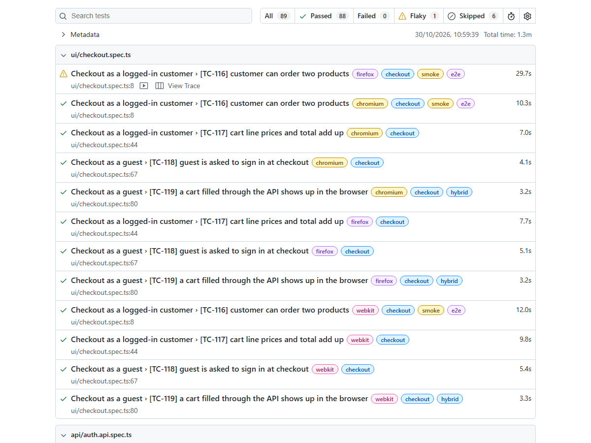
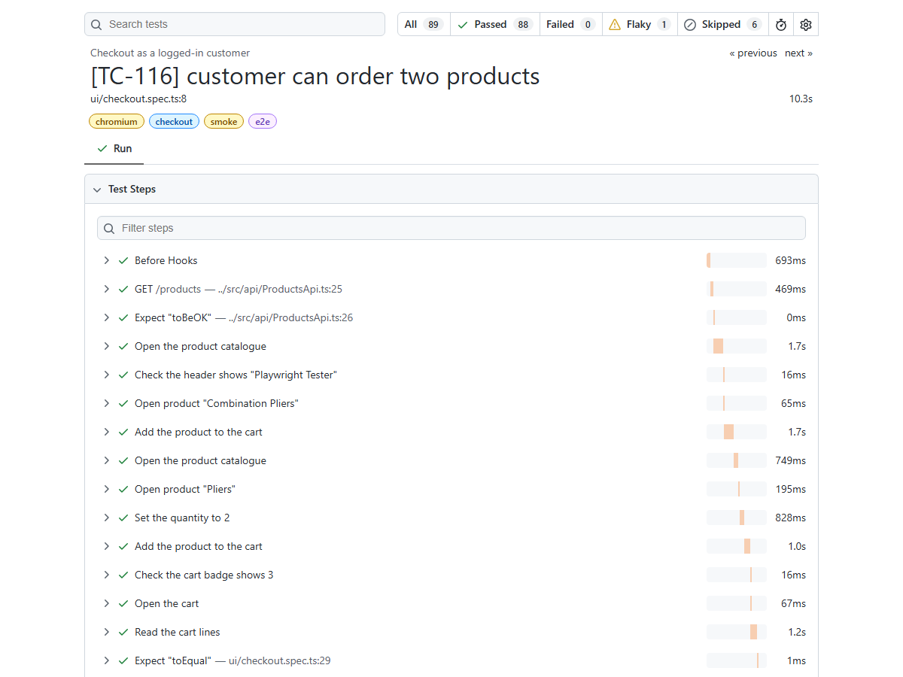

# Playwright + TypeScript Test Automation Framework

[](https://github.com/niranjankagri/playwright-typescript-framework/actions/workflows/ci.yml)

UI and API test automation for the [Practice Software Testing Toolshop](https://practicesoftwaretesting.com),
a demo web shop built for testers (Angular front end + REST API), written with
[Playwright Test](https://playwright.dev) and TypeScript.

**47 tests, 95 test runs per full run:** 23 API tests, plus 24 UI tests on Chromium, Firefox and WebKit.

| Area           | What is tested                                                                                           |
| -------------- | -------------------------------------------------------------------------------------------------------- |
| Login (UI)     | success, wrong password, empty form, sign out                                                            |
| Catalogue (UI) | product grid, search, no results, category filter, 4 sort options                                        |
| Product (UI)   | card vs. detail page, quantity, add to cart                                                              |
| Checkout (UI)  | full order of two products (invoice number), cart maths, guest sign-in step, cart filled through the API |
| Network (UI)   | mocked product list, empty list, 500 error; the requests the front end sends                             |
| Auth (API)     | registration, duplicate e-mail (409), JWT login, `/users/me`, wrong password, missing and forged token   |
| Products (API) | paging contract, no overlap between pages, by id, 404, search, sort, category filter                     |
| Carts (API)    | create, add, change quantity, remove, 422 validation errors, the "one Thor Hammer" business rule, 404    |

## Tech stack

|               |                                                                                                            |
| ------------- | ---------------------------------------------------------------------------------------------------------- |
| Test runner   | Playwright Test 1.64 (TypeScript, no extra compiler step)                                                  |
| Language      | TypeScript 6.0, strict mode                                                                                |
| API contracts | zod 4 schemas, which also provide the TypeScript types                                                     |
| Static checks | `tsc`, ESLint (typescript-eslint, type-aware + eslint-plugin-playwright), Prettier                         |
| CI            | GitHub Actions: checks, then 4 parallel jobs (api, chromium, firefox, webkit), then one merged HTML report |
| Node          | 20.12 or newer (CI uses 24)                                                                                |

## Quick start

```bash
npm ci
npx playwright install --with-deps   # browsers + their system libraries
npm test                             # everything: API + 3 browsers
```

| Command                                         | What it does                                             |
| ----------------------------------------------- | -------------------------------------------------------- |
| `npm test`                                      | all projects (api, chromium, firefox, webkit)            |
| `npm run test:api`                              | API tests only, no browser                               |
| `npm run test:chromium` (`:firefox`, `:webkit`) | UI tests in one browser                                  |
| `npm run test:smoke`                            | tests tagged `@smoke`                                    |
| `npm run test:headed`                           | Chromium with a visible window                           |
| `npm run test:ui-mode`                          | Playwright's UI mode (watch, time travel, pick locators) |
| `npm run report`                                | open the last HTML report                                |
| `npm run check`                                 | typecheck + lint + format check (what CI runs first)     |

Filter by tag or title, e.g. `npx playwright test --grep @checkout` or `--grep-invert @network`.
Tags: `@smoke`, `@negative`, `@e2e`, `@hybrid`, `@network`, and one per area
(`@login`, `@catalog`, `@product`, `@checkout`, `@auth`, `@products`, `@carts`).
API or UI is chosen with `--project` (`api`, `chromium`, `firefox`, `webkit`), not with a tag.

### Configuration

All settings are in [`src/config/env.ts`](src/config/env.ts), with defaults for the public demo.
Override them with environment variables or a local `.env` file (copy [`.env.example`](.env.example)):

| Variable   | Default                                   |
| ---------- | ----------------------------------------- |
| `BASE_URL` | `https://practicesoftwaretesting.com`     |
| `API_URL`  | `https://api.practicesoftwaretesting.com` |

No credentials to configure: every test worker registers its own customer through the API (see "Own test data" below).

## Project structure

```
src/
  config/env.ts            settings (env vars, .env, defaults)
  pages/                   page objects: BasePage, HomePage, ProductPage, LoginPage, AccountPage, CheckoutPage
  components/              HeaderComponent (shared by every page: user menu, cart badge)
  api/                     AuthApi, ProductsApi, CartsApi (service objects) + schemas.ts (zod contracts)
  fixtures/test.ts         the extended `test`: page objects, API clients, testUser, loggedIn option
  data/                    test data builders (new users, mocked products, billing address)
  utils/                   step decorator, bot-check skip, money (exact cents), sorting check
tests/
  api/                     *.api.spec.ts: no browser
  ui/                      *.spec.ts: run once per browser project
playwright.config.ts       projects, timeouts, reporters, evidence on failure
.github/workflows/ci.yml   CI pipeline
```

## Design decisions

**Page objects and a header component.** Each page object owns its locators and offers user actions
(`addToCart()`, `payWith('Cash on Delivery')`) and state checks (`expectOrderConfirmed()`). The navigation bar has no URL
of its own, so it is a component that every page object gets through `BasePage`. Tests read as steps and contain no
selectors.

**Readable reports with a `@step` decorator.** Page-object methods are marked like
`@step('Open product "{0}"')` ([`src/utils/step.ts`](src/utils/step.ts)). Each call becomes one named step in the
report and the trace, with its clicks and checks folded inside, and a failure points at the test line that called it.
Passwords never go into a step title.

**`data-test` locators.** The shop marks its elements with `data-test="..."`; `testIdAttribute: 'data-test'` makes
`page.getByTestId()` use it. Where an element has none, the locator uses its ARIA role (`getByRole('alert')`) or a stable id.

**Fixtures instead of `new`.** [`src/fixtures/test.ts`](src/fixtures/test.ts) extends Playwright's `test`. A test lists
what it needs (`async ({ homePage, cartsApi }) => ...`) and gets fresh objects for its own page. Fixtures are lazy, so an
API test never starts a browser.

**Login through the API, per test.** `test.use({ loggedIn: true })` logs in with one API call and puts the JWT
into `localStorage` before the page loads (`page.addInitScript`). It skips the login form (covered by its own tests) and
gives every test a fresh token. A login saved once per run (`storageState`) was not an option: the shop's tokens expire
after 5 minutes.

**Typed API clients with zod contracts.** The service objects check every response with a zod schema
([`schemas.ts`](src/api/schemas.ts)), and the same schema gives the TypeScript type, so the two cannot drift apart. The
schemas found a real inconsistency on day one: `/products` returns `category.slug`, `/products/search` leaves it out, and
products inside a cart have no category or brand at all.

**Hybrid tests.** UI tests use the API where clicking would only be set-up: one test fills a cart through the API, hands
the cart id to the browser (`sessionStorage`) and checks that the cart page shows exactly that.

**Network control.** [`network.spec.ts`](tests/ui/network.spec.ts) uses `page.route()` to serve an exact product list,
an empty list and a server error, and `waitForRequest` / `waitForResponse` to check what the front end sends. The mocks
come from typed builders and pass through the real schema, so they cannot drift from the real API. One finding: the
front end sends list filters in the body of an HTTP `QUERY` request, not in the URL.

**Own test data on a shared, live demo.** Other people use the same shop at the same time, and during the build the data
changed under the tests three times: someone's tests added a product to the "Hammer" category, someone changed the name
and password of the demo's published customer account, and this suite's own orders used up the stock of a product.
So the tests own or look up everything they depend on:

- **Users:** the `testUser` worker fixture registers a fresh customer through the API (unique `@example.com` address,
  random password), one per worker process. Nobody else can change it.
- **Products:** tests that buy something pick products that are in stock right now (`findInStockOnFirstPage()`).
- **Counts:** the catalogue tests ask the API what to expect at run time instead of hard-coding numbers.
- **Carts:** every API cart test creates its own cart.

CI also retries twice, to tell a real failure from a network hiccup.

**No fixed waits.** No `waitForTimeout` anywhere (an ESLint rule enforces it). Web-first assertions retry on their own,
and where a list re-renders, `expect.poll()` re-reads it until it is right, e.g. the sort tests.

**Money in cents.** Prices are parsed into whole cents (`"$14.15"` → `1415`), so line totals and cart totals are compared
exactly, without floating-point surprises.

**Evidence only for failures.** Trace and screenshot are kept for failed tests, video only on a retry. Recording video for
every test and throwing it away on success made each test about 25 seconds slower locally (video encoding at teardown).

## Reports

Playwright's HTML report (`npm run report`, or the `playwright-report` artifact of a CI run). A full local run, 95 of
95 passed, API first:



One end-to-end test opened. Thanks to the `@step` decorator the steps read like the test, and every step expands into
the clicks and checks it made:



A failed test also gets a screenshot, the trace (`npx playwright show-trace <trace.zip>`: every action with DOM
snapshots, network and console) and a page snapshot (`error-context.md`). On a retry it also gets a video.

## CI

[`.github/workflows/ci.yml`](.github/workflows/ci.yml) runs on every push and pull request, by hand, and every night
(the demo can change without a commit here):

1. **checks**: `npm run check` (typecheck, ESLint, Prettier). Nothing else starts if this fails.
2. **tests**: four parallel jobs, `api`, `chromium`, `firefox`, `webkit`; each installs only its own browser and uploads
   a blob report, also when tests fail.
3. **report**: merges the blob reports into one HTML report for all four projects (artifact `playwright-report`).

On CI there are 2 retries, 2 workers per job, and `forbidOnly`, so a forgotten `test.only` fails the build. Each test
job also uploads its JUnit XML (`junit-<project>`), which [Automation Coverage & Quality Intelligence](https://github.com/niranjankagri/automation-coverage-quality-intelligence) collects.

Dependabot proposes dependency and GitHub Actions updates once a month (minor and patch updates grouped, major versions as separate pull requests).

`main` is protected by a ruleset: every change goes through a pull request, and the CI jobs above must pass before it is merged.

## Lessons from building it

- `expect(response).toBeOK()` is an **async** matcher in Playwright. ESLint (`no-floating-promises`) found nine places
  where it was not awaited, so a failed status could have passed silently.
- `typescript-eslint` does not support the TypeScript 7 native compiler yet, so TypeScript is pinned to 6.0.
- Without `Accept: application/json`, the API answers validation errors with a 302 redirect instead of a 422 JSON body.
- The cart lives in the browser's `sessionStorage` (`cart_id`), the login in `localStorage` (`auth-token`).
- On GitHub's runners, a login through the form makes the site's Cloudflare protection show "Performing security
  verification" instead of `/account`, and then for every page of that browser session (found in the CI run's
  `error-context.md`). That is the site protecting itself, so the tests do not try to get past it:
  [`skipIfBotCheck()`](src/utils/botCheck.ts) waits for the account page or the check page and, on the check page,
  marks the two form-login tests as **skipped with that reason**. They run in full locally. On CI the login is still
  covered: the redirect is checked before the skip, the API tests log in, and the checkout tests log in through the API.
- The checkout test was flaky in CI (3 of 12 runs, passed on retry): the page stayed on "Payment was successful".
  The trace showed why: `POST /invoices` answered **422** "The city does not belong to the selected country" for the
  same valid address (1010 Vienna, Austria) that the retry ordered successfully, and the page shows no error. That is
  the shared demo rejecting a valid order, so the test is not changed to get around it;
  [`payWith()`](src/pages/CheckoutPage.ts) now waits for that response and fails with the shop's own reason instead
  of a 10 s wait for a confirmation that never comes.
- Recording a video of every test (`retain-on-failure`) cost about 25 s per test locally, which the trace showed as
  teardown time; `on-first-retry` keeps video for the runs that need it.

## License

[MIT](LICENSE)
